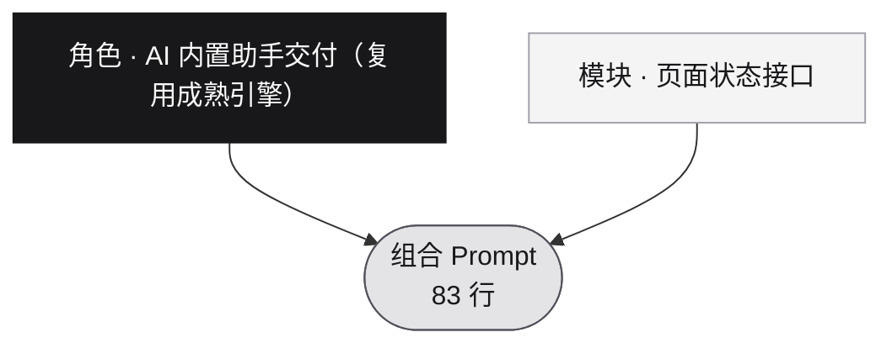

# 组合：AI 内置助手交付（复用成熟引擎）

> 角色：`prompts/ai/builtin-assistant.md` ｜ 模块：`modules/page-state-api.md`
> 由 `node scripts/build-combos.mjs` 生成于 2026-10-24；点下方代码块右上角按钮一键复制。

## 架构



## 组合 prompt

```text
本项目包含 Agent，请在通用产品开发规范之外，执行以下附加要求。

1. Agent 必须复用成熟引擎

默认优先评估 Pi 等具备官方 SDK、RPC、会话管理及工具扩展机制的成熟平台；已有满足需求的引擎优先保留。

禁止自行重写 agentic loop、工具调用循环、上下文压缩、会话恢复、模型适配等平台已有的核心机制；业务代码只负责产品能力、必要适配、界面呈现和项目特有规则。

在确定引擎前，读取当前官方文档，实际验证所需的模型、会话续接、工具注册、流式事件、取消与部署能力，确认适配后再扩大实现。

Pi 以当前官方 SDK、RPC 和扩展文档为准；Rust／Tauri 优先通过官方 RPC 等跨进程接口连接，需要 SDK 时使用受控的运行时或 sidecar，并验证打包、依赖、退出和异常恢复。

2. 前后端按职责模块化

分别组织 Agent 引擎适配、会话与任务、消息与事件、业务工具、应用上下文、持久化和 React 界面，模块间通过明确的类型与契约交互。

对话界面默认优先评估 assistant-ui，加载其适用的官方 runtime、tools、thread-list、streaming 等 Skills；需要 CopilotKit 等方案时，应证明它解决了具体缺口，并保持引擎与状态归属清晰。

优先使用成熟组件和官方适配器；没有现成适配器时，只实现必要的协议转换，不能在适配层中再写一套执行循环。

界面保持第一段约定的 Tailwind CSS、设计语言和动效规范，将可复用的对话、输入、消息、工具卡片和会话操作组件集中维护。

3. 会话稳定性是不可随意改变的产品约束

明确区分页面位置、当前业务对象、应用对话、引擎会话、执行任务和工具调用，并维护稳定标识及映射关系。

导航、切换会议、查看资料、展开收起面板和修改主题，均不得隐式新建或切换 Agent 会话；只有明确的会话操作才能改变活动会话。

上下文变化通过独立机制提供给 Agent，不能通过重建会话实现；组件挂载、重新渲染、事件订阅和重连不得产生幽灵会话或重复任务。

历史记录、执行状态和待处理交互应有明确的持久化及恢复归属，避免前端、适配层和底层引擎各自维护互相矛盾的状态。

4. 应用能力标准化，用户与 Agent 共用业务规则

建立统一能力注册机制，为每项工具定义名称、用途、输入输出、参数校验、目标对象、执行位置、权限、取消与错误语义，以及适用的幂等和确认策略。

用户按钮和 Agent 工具应调用相同的业务能力，禁止分别实现保存、删除等逻辑；业务写入与权限必须在实际执行边界校验，不能只依靠界面限制。

分别提供读取应用上下文、查询业务信息、控制界面和修改业务数据的适用工具；通过引擎官方扩展机制注册，按项目需要采用标准协议。

写操作必须明确目标对象和必要版本信息，发起执行后不得因页面切换而改变目标；发现上下文失效或冲突时，采用明确的重新获取、提示或确认策略。

5. 对话与工具执行必须形成完整交互

文本、工具调用、工具结果、状态和错误分别建模，使用稳定的消息及调用标识更新和去重，不能通过解析展示文案判断执行状态。

长工具参数与结果默认紧凑展示并允许展开；等待确认、执行中、成功、失败、拒绝和取消应清楚可辨，最终回答保持可读。

处理流式内容、长对话、中文输入法、发送与停止、复制、滚动位置及加载历史；用户主动向上阅读时，不得被持续输出强制拉回底部。

工具成功、业务保存成功、Agent 运行结束和最终回答完成分别判断；工具成功但回答失败时应准确保留成功结果，并提供适用的恢复入口。

6. 验证异常和长期运行

明确并验证停止、取消、超时、断线、重连、引擎退出、应用重启和待确认操作恢复后的行为；写操作应有适用的幂等与重复检测，不能仅依靠按钮禁用或防抖。

恢复会话时沿用有效的引擎续接机制；保留真实错误和已完成结果，禁止静默创建新会话掩盖恢复失败。

检查工具输出体积、长历史渲染、订阅清理、子进程生命周期及资源占用，按实际场景限制无界增长。

7. 使用真实引擎和真实业务进行验收

通过 CDP 或 browser neo 操作实际界面，并结合引擎事件、后端日志和数据结果验证；模拟回复只用于开发辅助，不能作为真实 Agent 接入完成的证据。

至少验证：
同一会话内切换页面与业务对象，历史和会话标识保持稳定；
上下文能正确反映当前浏览位置，工具操作对象不发生串用；
用户与 Agent 完成同一操作时结果一致，刷新或重启后数据正确；
长工具内容可用，等待、成功、失败和最终回答不会混淆；
取消、超时、重复事件、断线恢复和引擎异常不会造成重复写入或幽灵会话；
长对话及响应式布局下，输入、滚动和关键操作仍正常。

必须按“引擎接入—会话—工具—业务结果—界面反馈—持久化—异常恢复”完成整条链路，禁止因为 Agent 能回复一句话、能调用一个工具或界面看起来完整就停止开发。

未达到约定验收标准时继续修复和回归，交付时说明实际使用的平台、组件、版本、适配边界、验证证据与剩余限制。

【扩展模块】页面状态接口 —— 把页面状态暴露给 Agent 的设计约束

1. 每个页面／视图提供 getState()：返回结构化 JSON（路由与层级、组件树摘要、业务对象标识、表单值、选中项、加载态、错误态）；禁止依赖 DOM 快照或截图推断状态。
2. 提供 describeActions()：列出当前上下文下 Agent 可执行的操作、参数 schema 与前置条件。
3. 状态 schema 版本化（stateVersion 字段），字段演进保持向后兼容；不兼容变更必须升主版本并保留旧通道过渡。
4. 状态变化通过事件／订阅推送，禁止 Agent 轮询；高频更新做节流与合并。
5. 敏感字段（密钥、令牌、隐私数据）脱敏后才能进入模型上下文。
6. 提供确定性错误码：状态不可用、视图未挂载、权限不足时返回明确错误，不返回猜测数据。
```
